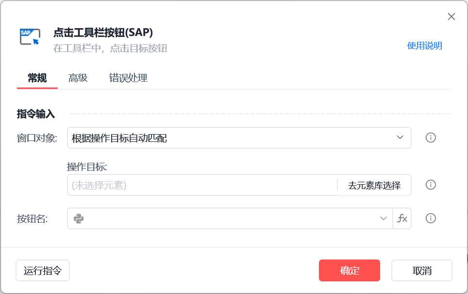
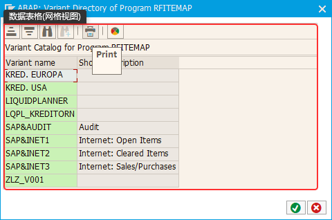
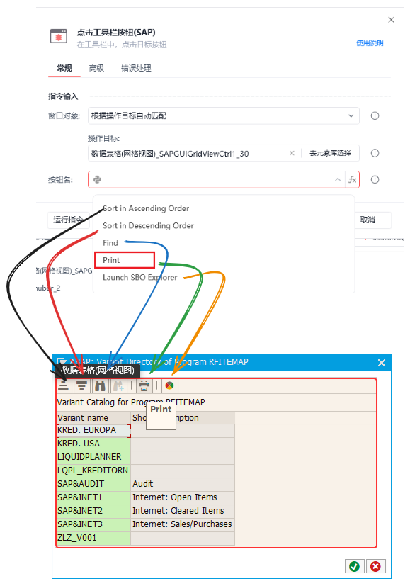
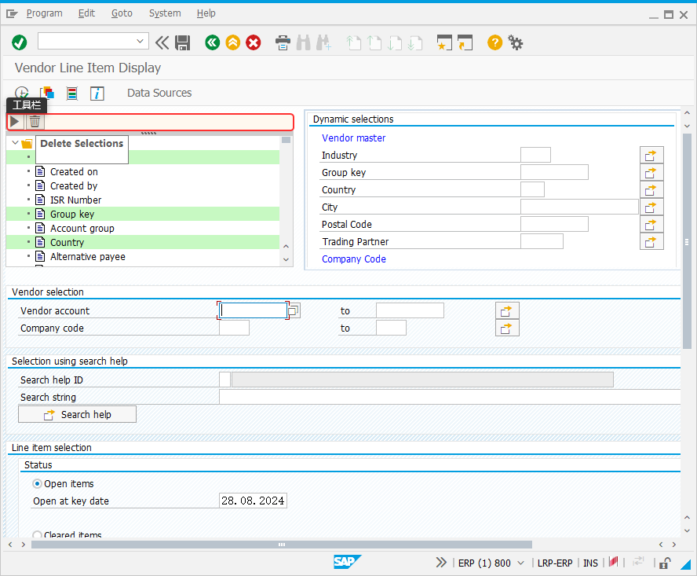
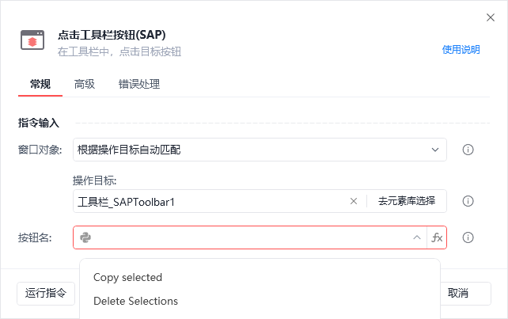
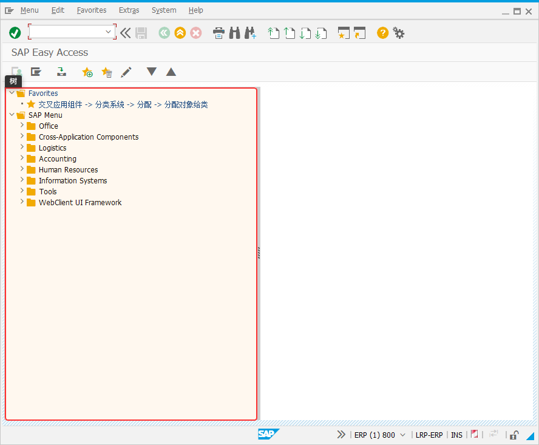
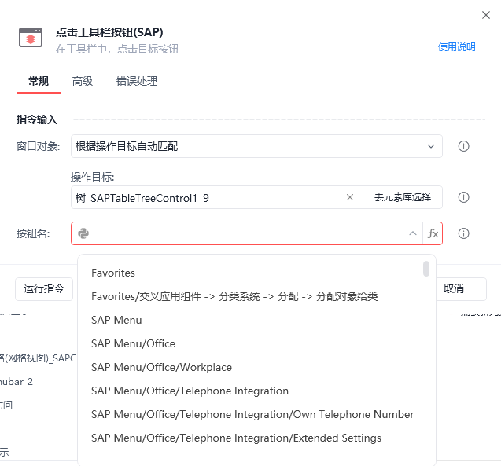
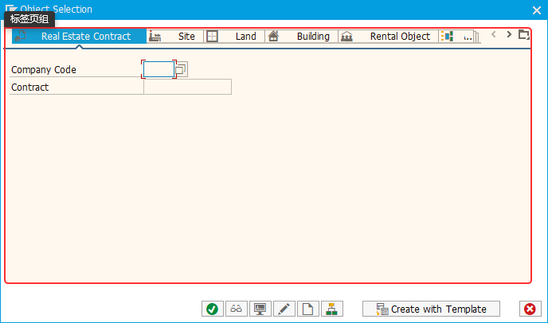
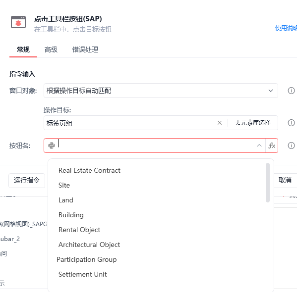

# 点击工具栏按钮(sap)

点击工具栏按钮(SAP)

使用【点击工具栏按钮(sap)】指令点击指定工具栏的按钮

🎬 视频课程：【影刀RPA场景教程】SAP自动化

指令面板

窗口对象：

根据操作目标自动匹配或选择一个之前通过【获取窗口对象】指令创建的窗口对象

操作目标：

从「元素库」中选择一个已捕获的元素或通过「捕获新元素」来捕获新的窗口元素作为操作目标

按钮名：

选择完元素后，下拉框会自动填充可选的值

使用示例

此时只需捕获操作的子面板即可，指令会自动识别捕获子面板内包含的按钮

1.点击数据表格（网格视图）内部的按钮

如下图所示捕获数据表格面板：

指令会自动识别所包含的按钮，在下拉展开框中选择即可

2.点击工具栏内部的按钮

3.点击树节点

该指令和【展开树节点】的区别在于，该指令在展开树节点后会双击树节点

4.点击标签页组内部的标签页

