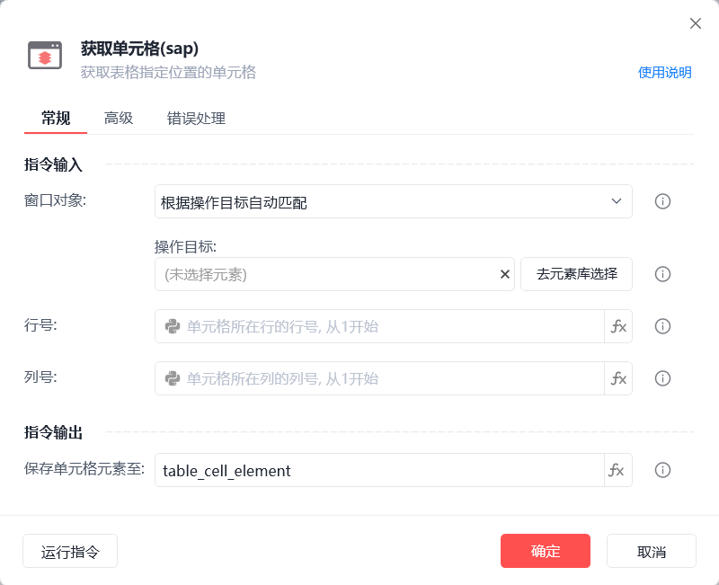

# 获取单元格(sap)

获取单元格(sap)

获取表格指定位置的单元格（5.22版本已下架此条指令）

🎬 视频课程：【影刀RPA场景教程】SAP自动化

窗口对象

根据操作目标自动匹配或选择一个之前通过【获取窗口对象】指令创建的窗口对象

操作目标

从「元素库」中选择一个已捕获的元素或通过「捕获新元素」来捕获新的窗口元素作为操作目标

行号

单元格所在行的行号, 从1开始

列号

单元格所在行的列号, 从1开始

保存单元格元素至

保存获取到的单元格元素为变量

等待元素存在(s)

等待目标元素存在的超时时间

使用示例

此流程执行逻辑：使用【获取单元格(sap)】指令获取指定位置的单元格对象并保存

常见问题

SAP元素无法捕获

SAP元素失效

SAP点击元素后无反应
