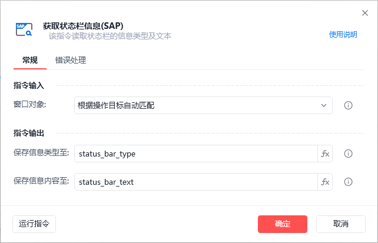
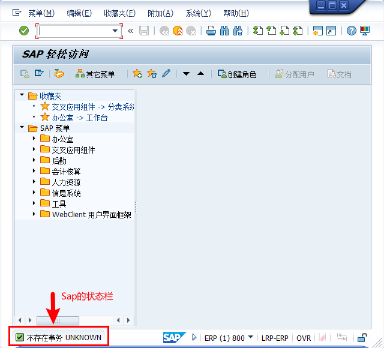
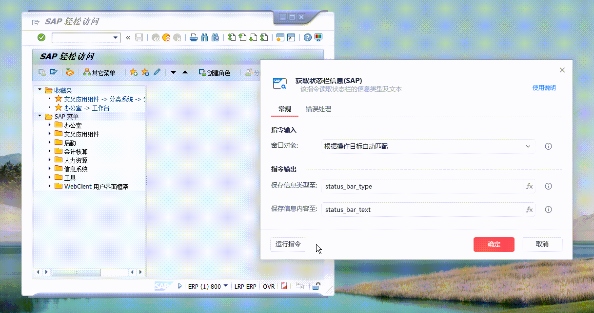

# 获取状态栏信息(sap)

获取状态栏信息(sap)

获取指定的窗口对象所在的SAP会话中状态栏的状态以及文字描述

🎬 视频课程：【影刀RPA场景教程】SAP自动化

指令面板

窗口对象:

自动匹配窗口对象或选择一个之前通过【获取窗口对象】指令创建的窗口对象

保存信息类型至：

获取状态栏中的消息类型, 共有7种: "Information", "Status", "Warning", "Error", "Termination", "Exit"和"", 其中空字符串代表状态栏没有信息

保存信息内容至：

获取状态栏中的消息

使用示例

