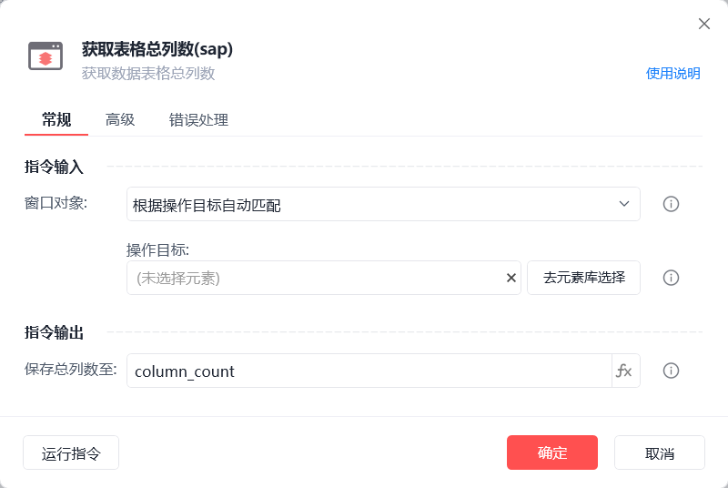

# 获取表格总列数(sap)

获取表格总列数(sap)

获取数据表格总列数

🎬 视频课程：【影刀RPA场景教程】SAP自动化

窗口对象

根据操作目标自动匹配或选择一个之前通过【获取窗口对象】指令创建的窗口对象

操作目标

从「元素库」中选择一个已捕获的元素或通过「捕获新元素」来捕获新的窗口元素作为操作目标

保存总列数至

保存获取的总列数为变量

等待元素存在(s)

等待目标元素存在的超时时间

使用示例

此流程执列逻辑：使用【获取表格总列数(sap)】指令获取指定数据表格的总列数并保存

常见问题

SAP元素无法捕获

SAP元素失效

SAP点击元素后无反应
