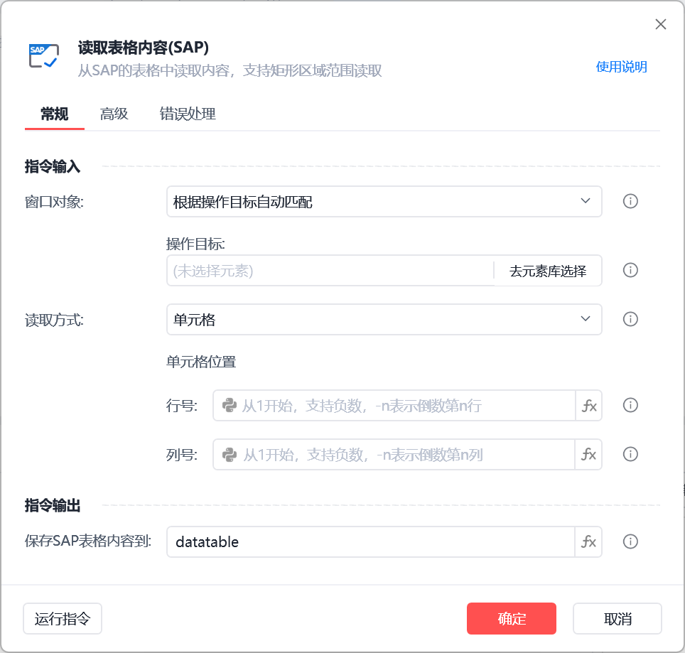
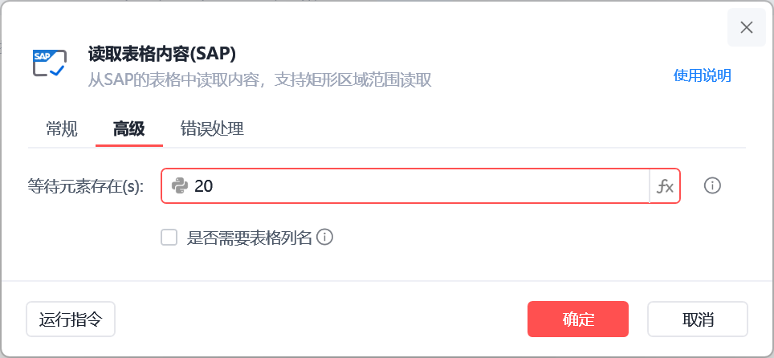
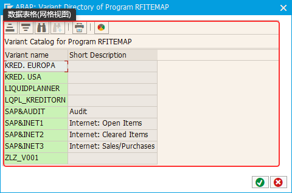
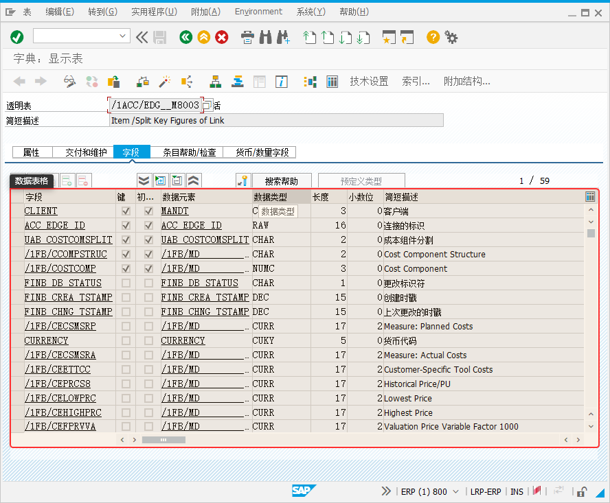

# 读取表格内容(SAP)

读取表格内容(SAP)

该指令可以读取sap指定表格内的数据

🎬 视频课程：【影刀RPA场景教程】SAP自动化

指令面板

窗口对象

根据操作目标自动匹配或选择一个之前通过【获取窗口对象】指令创建的窗口对象

操作目标

从「元素库」中选择一个已捕获的元素或通过「捕获新元素」来捕获新的窗口元素作为操作目标

读取方式

单元格

行号

列号

区域内容

起始单元格行号

起始单元格列号

末尾单元格行号

末尾单元格列号

行

行号

列

列号

全部内容

高级选项中可以选是否读取表格列名

使用示例

捕获表格面板即可

数据表格（网格视图）

数据表格

