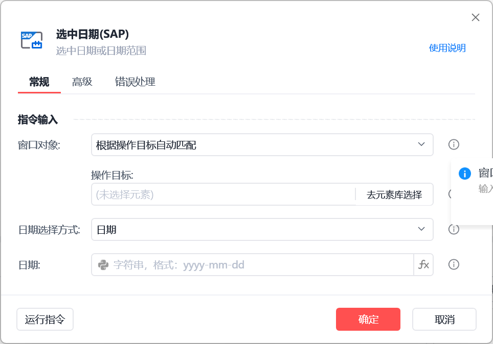

# 选中日期(SAP)

选中日期(SAP)

该指令根据操作目标自动匹配窗口并选中指定日期或日期范围

🎬 视频课程：【影刀RPA场景教程】SAP自动化

指令面板

窗口对象：

根据操作目标自动匹配或选择一个之前通过【获取窗口对象】指令创建的窗口对象

操作目标：

从「元素库」中选择一个已捕获的元素或通过「捕获新元素」来捕获新的窗口元素作为操作目标

日期选择方式：

填写日期选择方式，可选值有：日期、日期范围、周
