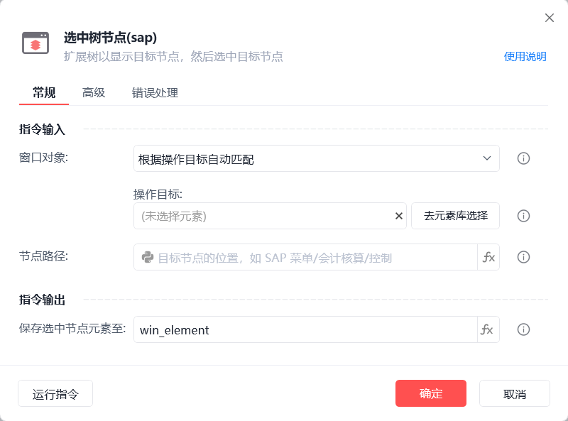
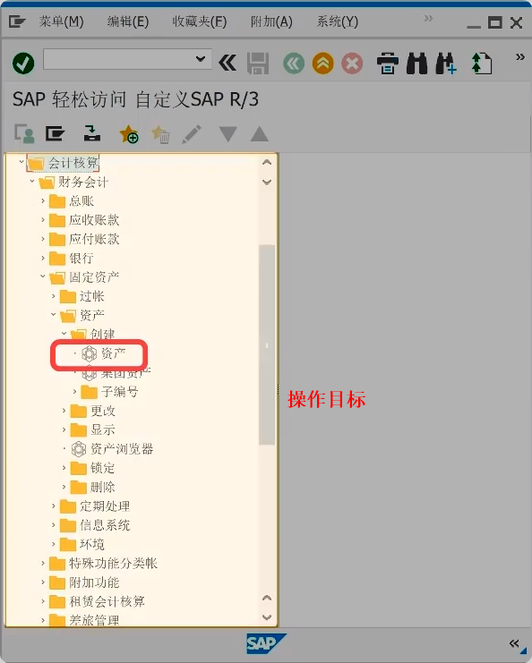
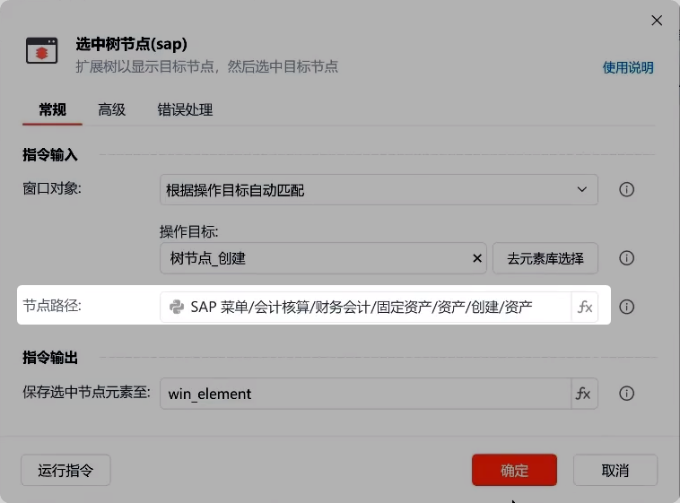

# 选中树节点(sap)

选中树节点(sap)

扩展树以显示目标节点，然后选中目标节点

🎬 视频课程：【影刀RPA场景教程】SAP自动化

注：操作前需先完成SAP自动化配置

窗口对象

根据操作目标自动匹配或选择一个之前通过【获取窗口对象】指令创建的窗口对象

操作目标

从「元素库」中选择一个已捕获的元素或通过「捕获新元素」来捕获新的窗口元素作为操作目标

节点路径

填写目标节点的位置路径，如：SAP 菜单/会计核算/控制

保存选中节点元素至

保存获取到的树节点元素为变量

等待元素存在(s)

等待目标元素存在的超时时间

使用示例

此流程执行逻辑：使用【选中树节点(sap)】指令根据操作目标自动匹配窗口并选中指定路径的树节点

常见问题

SAP元素无法捕获

SAP元素失效

SAP点击元素后无反应
