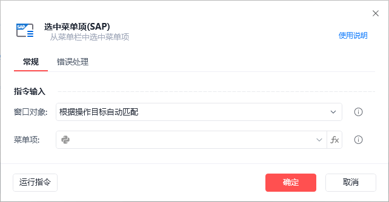
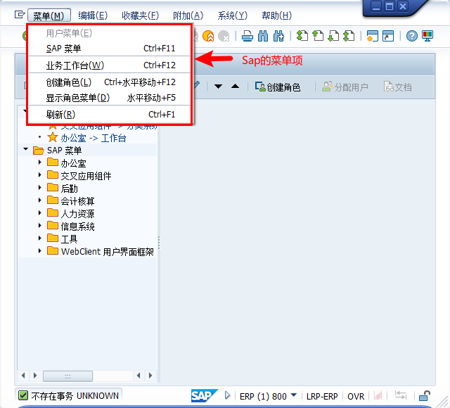
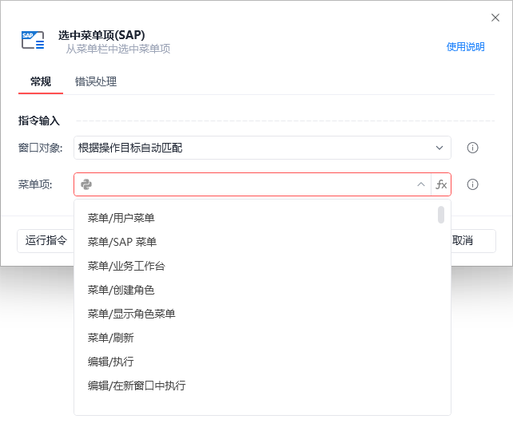

# 选中菜单项(sap)

选中菜单项(sap)

选中指定的窗口对象所在的SAP会话中指定菜单栏项

🎬 视频课程：【影刀RPA场景教程】SAP自动化

指令面板

窗口对象:

自动匹配窗口对象或选择一个之前通过【获取窗口对象】指令创建的窗口对象

菜单项：

指定菜单项的路径，如：菜单/用户菜单，该选项的下拉框会自动填充当前SAP会话的所有菜单项路径

使用示例

打开sap后即可以自动识别当前页面菜单项

